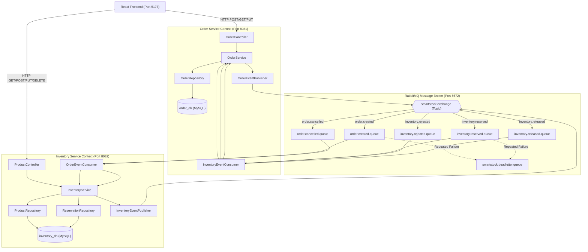

# SmartStock: Service-Oriented Architecture (SOA) Specification

## 1. System Overview

**SmartStock** is an enterprise-grade demonstration of Service-Oriented Architecture (SOA) applied to an on-demand quick-commerce grocery order and inventory fulfillment workflow. 

Rather than deploying a traditional monolithic system where order processing, inventory reservation, and product catalog share a single process space and unified database, SmartStock decomposes the problem domain into two autonomous, loosely coupled services:
1. **Order Management Service** (Port `8081`, Database: `order_db`)
2. **Inventory Management Service** (Port `8082`, Database: `inventory_db`)

Communication between services is orchestrated asynchronously using **RabbitMQ** (Topic Exchange) for state-changing workflows (order placement, stock reservation, stock rejection, and cancellation restoration), and synchronously using **REST APIs** for direct queries and catalog operations.

---

## 2. Monolith Analysis vs. SOA Decomposition

### 2.1 The Traditional Monolith Dilemma
In a traditional monolithic e-commerce architecture:
- Both order records and stock records reside within the same database schema.
- Stock reservation is executed through a local database transaction (e.g., `SELECT ... FOR UPDATE` followed by `UPDATE stock`).
- High-frequency browsing or order placement surges directly lock product inventory tables, causing database connection pool exhaustion and cascading failures.
- Scaling requires deploying multiple copies of the entire monolithic stack, including heavy order processing components, even when only the product catalog experiences high traffic.

### 2.2 Service Identification Process
To identify service boundaries, domain capabilities were isolated according to business ownership, operational cadence, and bounded context:
- **Product & Stock Ownership (Inventory Service)**: The inventory service is the single source of truth for product metadata, current on-hand stock, reserved stock, and availability invariants (e.g., non-negative inventory).
- **Order Lifecycle & Customer Contracts (Order Service)**: The order service is the authoritative source for order creation, customer historical snapshots, and order status transitions (`PLACED`, `CANCELLED`, `REJECTED`).

```
+-------------------------------------------------------------+
|                      Client Layer                           |
|             (React.js + Axios Interceptors)                 |
+------------------------------+------------------------------+
                               |
            +------------------+------------------+
            | REST (Port 8081)                    | REST (Port 8082)
            v                                     v
+-----------------------+             +-----------------------+
| Order Service         |             | Inventory Service     |
| - Order Lifecycle     |             | - Product Catalog     |
| - Customer Snapshots  |             | - Stock Management    |
| - Status Engine       |             | - Reservation Engine  |
+-----------+-----------+             +-----------+-----------+
            |                                     |
            | JPA                                 | JPA
            v                                     v
+-----------------------+             +-----------------------+
| order_db (MySQL)      |             | inventory_db (MySQL)  |
| - orders              |             | - products            |
| - service_event_logs  |             | - reservations        |
|                       |             | - processed_events    |
|                       |             | - service_event_logs  |
+-----------------------+             +-----------------------+
            ^                                     ^
            |       RabbitMQ Topic Exchange       |
            +============[ smartstock.exchange ]==+
                    (Durable Queues & Dead Letter)
```

---

## 3. High-Level Architecture Diagram



---

## 4. Key Architectural Guarantees

1. **Database Autonomy & Zero Shared Repositories**:
   - `order_db` contains solely `orders` and local event audit logs.
   - `inventory_db` contains `products`, `inventory_reservations`, `processed_events`, and local event audit logs.
   - Neither service has JDBC credentials, entity definitions, or foreign keys pointing to the other database.

2. **Historical Immutability (Snapshot Pattern)**:
   - When an order is placed, `Order` stores `product_name_snapshot` and `unit_price_snapshot`.
   - If an administrator later edits the product price or updates its name in Inventory Service, prior customer receipts remain accurate and untampered.

3. **Atomic Stock Updates & Concurrency Control**:
   - Stock reservations execute atomic conditional SQL updates:
     `UPDATE products SET available_quantity = available_quantity - :qty, reserved_quantity = reserved_quantity + :qty WHERE id = :id AND available_quantity >= :qty`
   - Even under heavy concurrent requests, overselling is physically prohibited at the database engine level.

4. **Event Idempotency & De-duplication**:
   - Every RabbitMQ event carries a unique `eventId` (UUID).
   - The Inventory consumer records processed event IDs in `processed_events`. Duplicate message deliveries are acknowledged and discarded without double-deduction.

---

## 5. Automated Verification & Testing Results

All 34 automated unit and integration tests across both microservices pass with 100% success:

| Test Suite | Location | Tests Run | Failures | Scope Verified |
|---|---|:---:|:---:|---|
| `ConcurrencyAndIdempotencyTest` | `inventory-service` | 3 | 0 | 10-thread race condition for last units; duplicate delivery deduplication; duplicate cancellation idempotency. |
| `InventoryReservationWorkflowTest` | `inventory-service` | 4 | 0 | Sufficient stock reservation; insufficient stock rejection; duplicate event discard; cancellation restoration. |
| `ProductControllerTest` | `inventory-service` | 8 | 0 | REST contracts for product CRUD, stock add/remove, availability check, and deletion guards. |
| `InventoryEventPublisherTest` | `inventory-service` | 3 | 0 | RabbitMQ topic exchange publishing for `InventoryReserved`, `InventoryRejected`, `StockReleased`. |
| `OrderWorkflowTest` | `order-service` | 6 | 0 | Status transitions (`PENDING` $\to$ `PLACED`/`REJECTED`, `PLACED` $\to$ `CANCELLED`), order history filters. |
| `OrderControllerTest` | `order-service` | 5 | 0 | REST contracts for order creation, customer history, admin live slip, and cancellation. |
| `InventoryClientContractTest` | `order-service` | 3 | 0 | Synchronous `RestClient` contract validation, 404 mapping, and live stock checking. |
| `OrderEventPublisherTest` | `order-service` | 2 | 0 | RabbitMQ topic exchange publishing for `OrderCreated` and `OrderCancelled`. |
| **Total** | **Both Services** | **34** | **0** | **100% Green Verification** |
