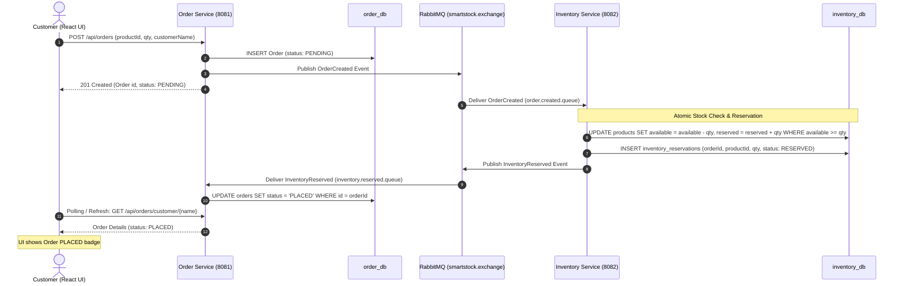
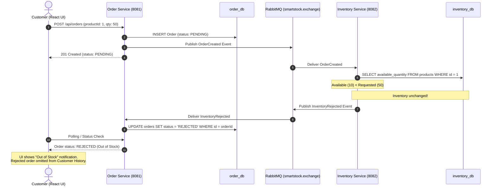
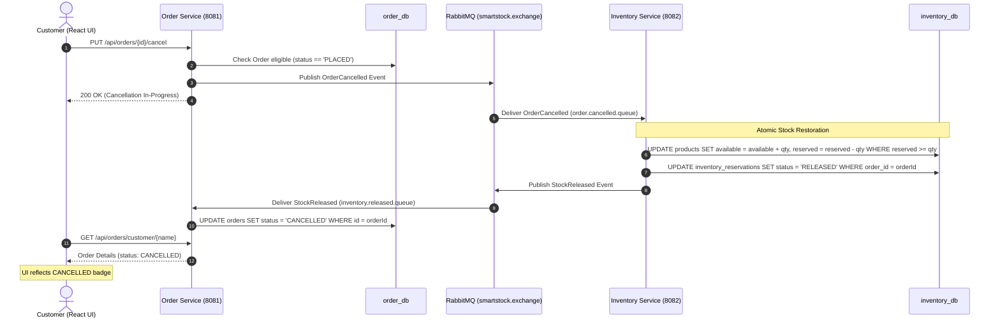

# SmartStock Service Interaction & RabbitMQ Event Workflows

## 1. Overview of Asynchronous Messaging

SmartStock decouples state changes between the **Order Management Service** and **Inventory Management Service** via **RabbitMQ**. All messages are routed through a topic exchange named `smartstock.exchange`.

### Exchange and Queue Topology

| Queue Name | Routing Key | Publisher | Consumer | Purpose |
|------------|-------------|-----------|----------|---------|
| `order.created.queue` | `order.created` | Order Service | Inventory Service | Trigger stock reservation check |
| `inventory.reserved.queue` | `inventory.reserved` | Inventory Service | Order Service | Confirm order placement (`PLACED`) |
| `inventory.rejected.queue` | `inventory.rejected` | Inventory Service | Order Service | Handle out of stock / reject order |
| `order.cancelled.queue` | `order.cancelled` | Order Service | Inventory Service | Trigger reserved stock release |
| `inventory.released.queue` | `inventory.released` | Inventory Service | Order Service | Confirm stock restored (`CANCELLED`) |
| `smartstock.deadletter.queue` | `smartstock.deadletter` | DLX | Monitoring / Admin | Catch repeated processing failures |

---

## 2. Sequence Diagrams

### 2.1 Scenario 1: Successful Order Placement & Stock Reservation

---

### 2.2 Scenario 2: Insufficient Stock (Order Rejection)

---

### 2.3 Scenario 3: Customer Order Cancellation & Stock Restoration

---

## 3. Idempotency & Fault Tolerance

1. **Event Deduplication**:
   - Each event contains an `eventId` (UUID).
   - The Inventory service stores processed event IDs in `processed_events`. If a duplicate `OrderCreated` arrives due to RabbitMQ redelivery, the consumer identifies the existing `eventId` and acknowledges the message without altering stock.

2. **Atomic Invariants**:
   - Total stock $T = A + R$ (Available + Reserved).
   - Available stock $A \ge 0$.
   - Reserved stock $R \ge 0$.
   - When an order is placed: $A \leftarrow A - Q$, $R \leftarrow R + Q$ ($T$ is constant).
   - When an order is cancelled: $A \leftarrow A + Q$, $R \leftarrow R - Q$ ($T$ is constant).
   - Admin adding stock $\Delta S$: $T \leftarrow T + \Delta S$, $A \leftarrow A + \Delta S$.
   - Admin removing stock $\Delta S$: strictly allowed only if $A \ge \Delta S$.
